

  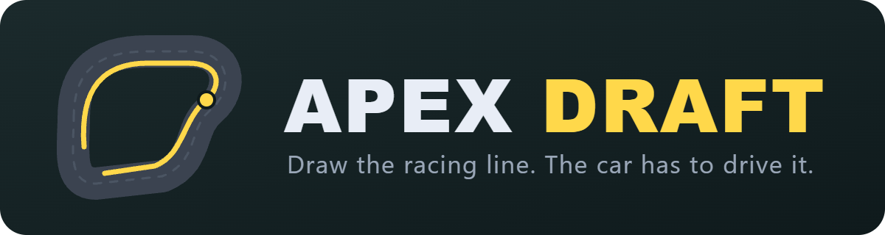

  <b>A racing game where you never touch the wheel.</b> 
  You draw the racing line. Your car has to drive it.

  <a href="https://github.com/dwatson251/apex-draft/releases">Download</a> ·
  <a href="#how-it-plays">How it plays</a> ·
  <a href="#race-modes">Race modes</a> ·
  <a href="#tyres-fuel-and-weather">Tyres</a> ·
  <a href="#seeded-tracks">Seeded tracks</a> ·
  <a href="DEVELOPER.md">Developing</a>

  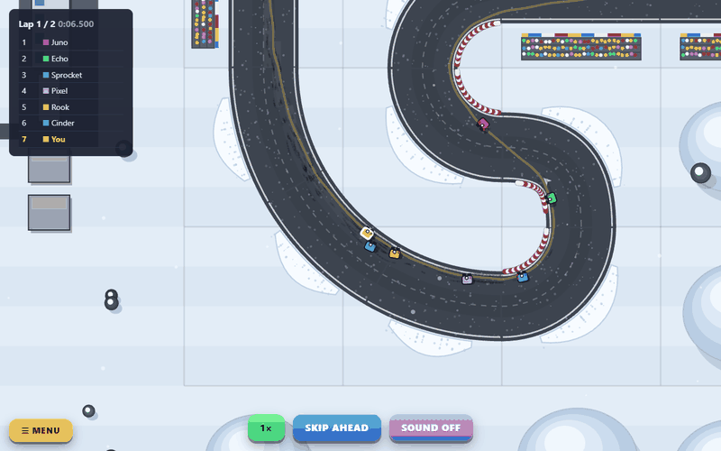

---

Apex Draft turns racing into a puzzle about lines. The track is revealed one piece at a time, and you only see the piece
you are drawing on. Place points, bend the line round the corner and move on to the next piece without knowing what
comes after it. When the lap is done the race starts, and you watch your car drive exactly what you drew, against up to
31 rivals who each drew their own.

The car does what a car does. It brakes for tight bends, runs out of grip if you ask too much of it, pulls hardest off
the line and fades toward its top speed, and has one grip to share between turning and braking. A good line is short,
smooth and keeps the speed up. A bad one can be pretty and slow, and the game shows you which is which: your line is
drawn in speed colours, with the lap time it is worth, before you ever race it.

**At a glance**

- Draw a lap a piece at a time, see where it is slow, race it against up to 63 rivals.
- Random tracks from a phrase, about forty real circuits hidden behind their names, nine places and twenty-four machines.
- Quick Race, Race Weekend, a Career from karts to hypercars, a Championship, Elimination races, Time Trial, the Daily,
  Line Golf, Challenges and Duels with your friends.
- Tyres, fuel, pit stops, rain that dries along the racing line, yellow flags and the safety car.
- Replays of your last races, clips you can save, trophies and an atlas of the circuits you have found.

> **Alpha.** Builds are unsigned, so Windows and macOS will warn you the first time you open one. Things will change.

## Download

Installers for Windows, Linux (AppImage) and macOS are on the
[Releases page](https://github.com/dwatson251/apex-draft/releases). There is nothing else to install.

**Android:** each release also has `apex-draft-<version>-debug.apk`. Download it on the phone, allow "install unknown
apps" for your browser or file manager, and open it. It is a debug build (not from the Play Store) and plays in landscape.

**Steam Deck:** download `ApexDraft-<version>-steamdeck-x86_64.AppImage`, then in Desktop mode make it executable (right-click,
Properties, Permissions, "Is executable", or `chmod +x`) and run it. To play in Game mode, add it with *Add a Non-Steam Game*, then
pick the **Gamepad** controller template so the Deck's buttons arrive as a standard pad. It goes fullscreen on its own in Game mode
(or run it with `--fullscreen`). Left stick moves the cursor, A places a point; the full list is under Settings. If it won't
start, run it once from a terminal and open an issue with what it prints.

## How it plays

  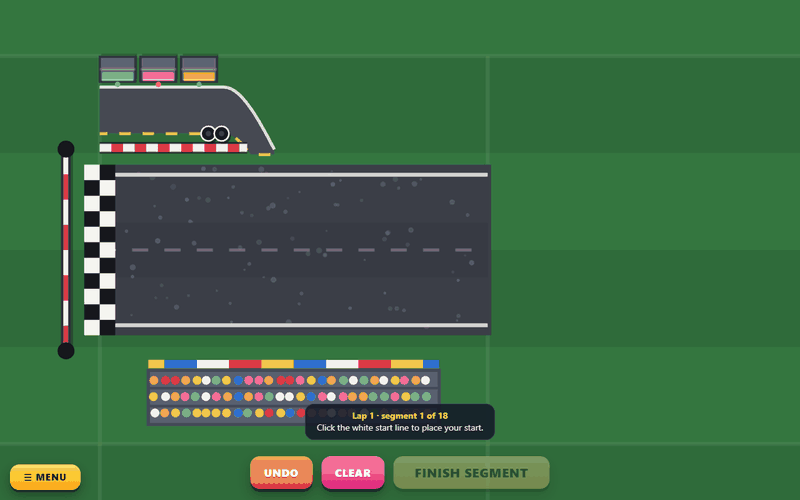

1. **Pick a track.** Type a phrase, or press Random. The phrase *is* the track (see [Seeded tracks](#seeded-tracks)).
   Or press **Play now** on the home screen: a random track, three laps, seven rivals, straight to drawing.
2. **Draw a lap.** Each piece of road is shown on its own. Click to place points and the line is drawn through them, in
   white; it turns red where it leaves the road. Press **Finish segment** and the next piece opens, starting from the
   yellow dot where your line left the last one. The pieces you have finished are drawn in **speed colours**: red where
   the car is slow, through amber, to green where it is fast. There is no limit on the number of points.
3. **Tidy up.** Every point can be dragged. The square at the start and the diamond at the end of a segment slide along
   the edge of the road. Right-click deletes a point, and Shift+click adds one between two others.
4. **Check the lap, then race.** The whole lap shows its speed colours and the **flying lap** it is worth in your car;
   redraw the red bits. Then the camera eases in on your car and follows it. Cars leave skid marks, throw up spray in the
   wet, hum with their speed and squeal in the corners (`M` mutes). The mouse wheel zooms while you watch, and
   **● Record** saves a clip.
5. **Amend in the pits.** Once the race is running, your line can only change during a pit stop: pick up to **three
   segments** on the map and redraw them before the car goes back out. Moving the point where two segments meet changes
   both, and both count. (A Time Trial or Practice lets you change it between runs.)
6. **Learn from it.** The results compare your line with the best computer line, in your car on a flying lap with
   nobody in the way: how much a lap it gains or loses, and the three segments where it loses most, lit on the map.
   **Watch replay** runs the race again.

  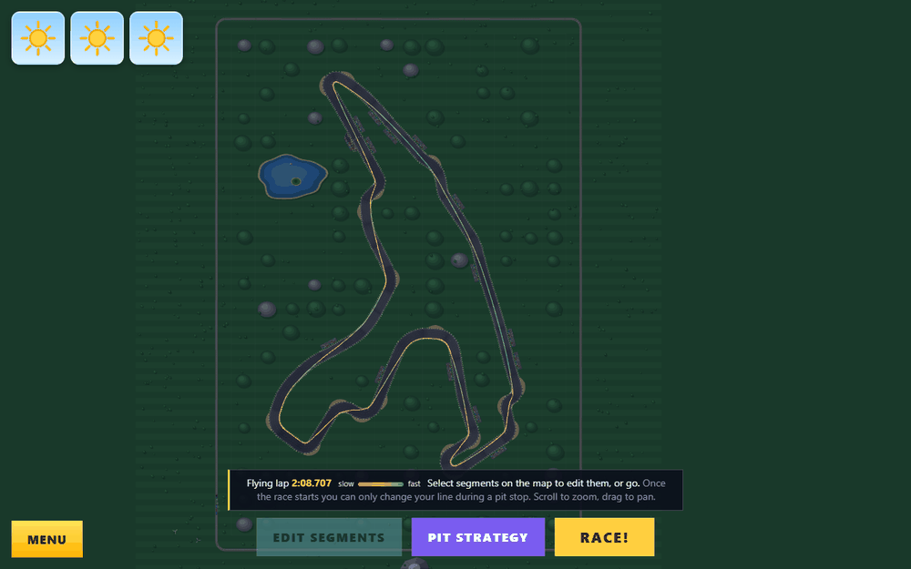
  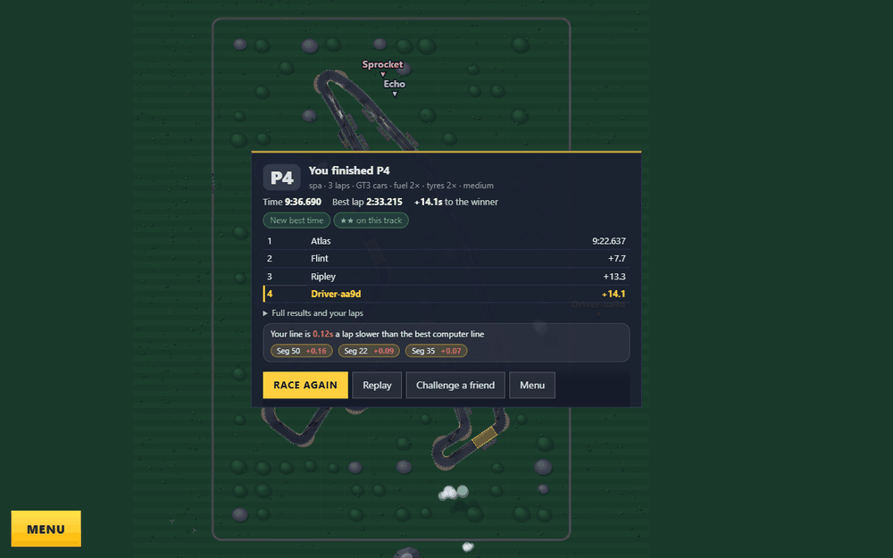

### Racing other cars

  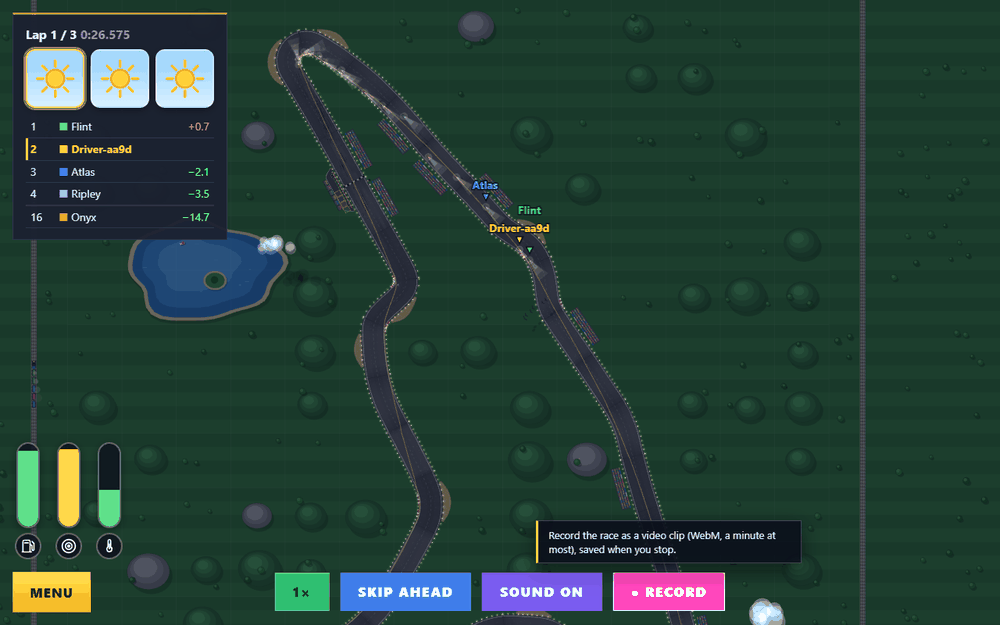

- **Rivals.** Up to 63 computer drivers can race you. They start in two staggered columns, quickest lap first (yours counts too),
  and each has its own line. Rivals on the same road give each other room and try not to touch, so the same line can
  give a different result against a different field. No car steers off its line to pass, yours or theirs: to get by a
  slower car, draw a line that goes past it.
- **Drafting.** Sit close behind a car, in its lane, and you get a slipstream: more top speed and acceleration, the
  closer you are and the faster you are going. It works in every mode.
- **Contact.** Cars can touch. A shunt from behind, a squeeze alongside and a T-bone each do what you would expect, and
  heavier vehicles push lighter ones around. A car carrying too much speed into a bend runs wide.
- **Yellow flags and the safety car.** Cars slow down past a wreck. When two cars are in trouble at once, or one is stuck,
  the safety car comes out: the leader is held to its pace and the field closes up behind, until the road is clear.
- **Other people.** Your times and lines go to the online server (`apexdraft.dnlwtsn.co.uk`) as you play, and other players' lines come
  back as rivals on the same track, picked to put you mid-pack. Their name shows above an arrow on their car. The server runs every
  line through the game's own simulation, so times can't be faked. Pick your name under **Settings**. If the server can't be reached
  the game says nothing and fills the grid with computer-driven rivals. See `server/README.md` to host your own.

### Your car

The **Garage** gives you 24 points to spend across acceleration, top speed, cornering and braking, and you can save
setups and paint your car: two colours, stripes and a number, and gold, chrome, chequers and chevrons once trophies open
them. The phrase decides what everybody drives: go-karts, formula cars, rally cars, muscle cars, trucks or tanks. A
kart corners like it is on rails and goes nowhere on the straight. A truck is the opposite. Superbikes lean into the bends.

## Race modes

Pick one from the main menu, where they are grouped as **Race** (Quick Race, Race Weekend, Elimination, Career, Championship) and **Time Attack** (Solo Time Trial, Daily, Line Golf, the Atlas), next to Play now and Challenges. The difficulty (how hard the rivals drive) is chosen on the race setup. Your drawn line carries over from one mode to the next on the same track, so you can
practise somewhere quiet and take the line into a race.

  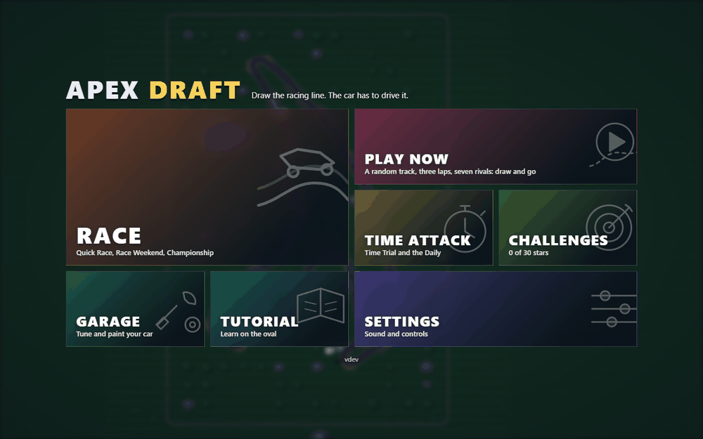
  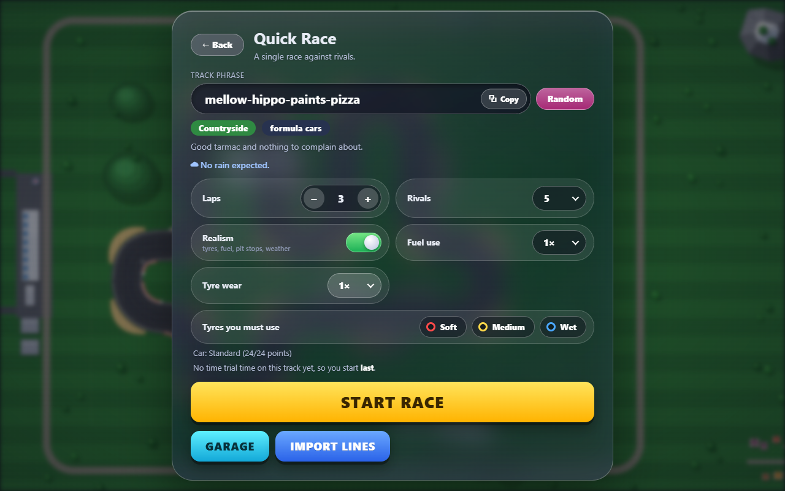

  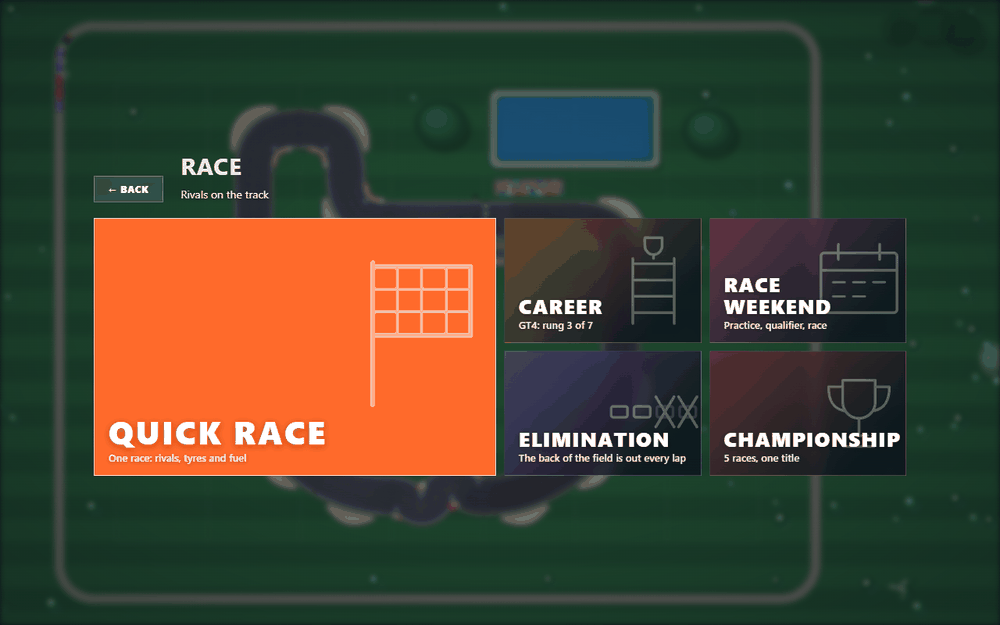
  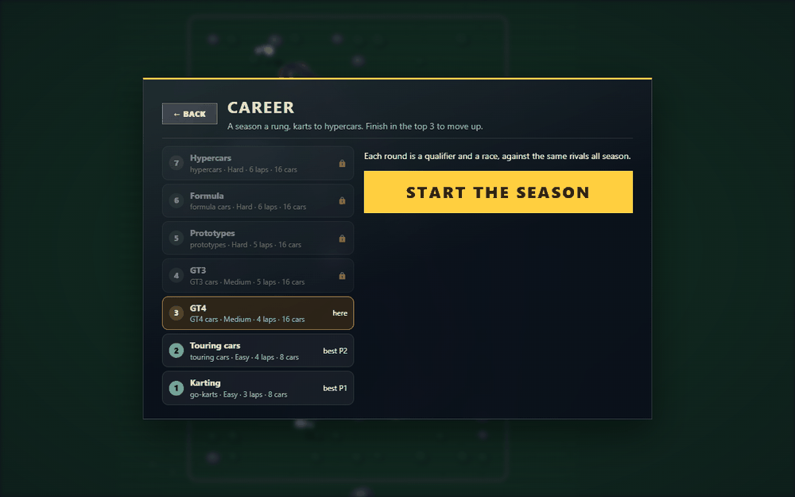

| Mode | What you get |
| --- | --- |
| **Solo Time Trial** | You, the track and the clock. An out lap, one timed lap and a cool-down lap. No rivals, no wear, soft tyres. Your best time is kept for that track, and it decides your grid place in Quick Race. |
| **Play now** | One tap from the home screen: a random track, three laps, seven rivals, no tyres or fuel. |
| **Quick Race** | A single race of up to 50 laps against up to 63 rivals. Turn **Realism** on for tyres, fuel, pit stops and weather. Scale wear and fuel use up to 40x to make a short race feel like an endurance one, and make some tyres mandatory. You start from the place your Time Trial time earns, or, with none, where the lap time of your line puts you. |
| **Race Weekend** | **Practice** has no wear, with the others spread round the track. It ends when you say or after 10 minutes, and you can edit your line between runs. **Qualifier** is an out lap, three timed laps and a cool-down, and your best lap counts. Then the **Race** starts from the grid you qualified for. |
| **Daily** | One track a day, the same for everyone, as a Time Trial in your own car. Your best, your streak and the online board for the day. |
| **Line Golf** | A course a day: beat the target lap with as few points as you can. Par comes from a line that can be drawn; three stars at par. |
| **Elimination** | Each time the leader starts a lap, the back of the field is out, a big field several at a time and then one a lap, down to a duel on the last lap. |
| **Career** | A ladder of seasons, one machine a rung: karts, touring cars, GT4, GT3, prototypes, formula cars and hypercars, the top rungs on real circuits. A top-three season moves you up. |
| **Championship** | Five races on linked tracks against the same rivals, with points for the places. Each round is a qualifier and a race. |
| **Challenges** | Ten races with a goal, worth one to three stars each. |
| **Duels** | *Challenge a friend* on your results copies a duel code: your line, car and name. A friend pastes it into the track phrase box and races your lap head to head. |
| **Tutorial** | A guided run on the oval: drawing, the speed colours, dragging, inserting and deleting points, locking in segments, queuing a pit stop and editing in the pits. |

  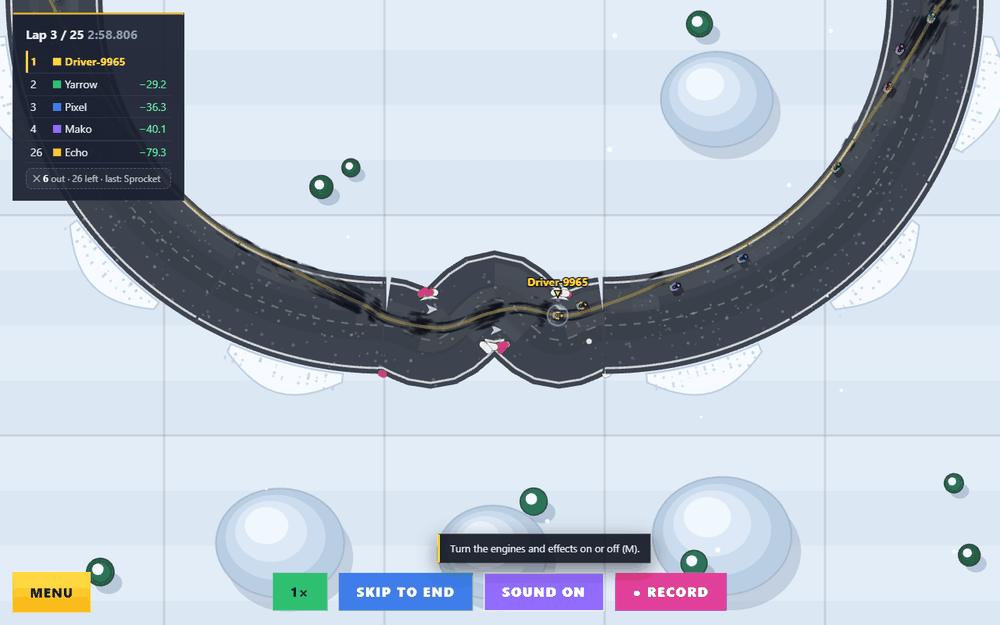
  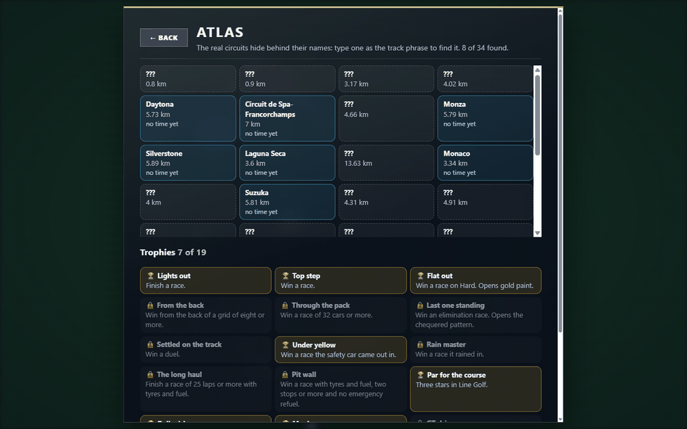

**Replays, clips, trophies.** Your last five races are kept to watch again (the results, or Settings), run again from what
went into them so they come out the same to the last tick. **● Record** on the race bar saves a WebM clip. Nineteen
trophies, and the **Atlas** of the real circuits you have found, are under Time Attack.

**Long races and strategy.** You can only change your line while you are in the pits, and then only up to three segments
per stop. On Medium and Hard you plan the stops: queue up to five, each with a lap to come in on and a tyre to fit. On
Easy the pit wall makes every call for you (it calls the stops as the computer drivers' are called: fuel, worn tyres,
the wrong tyre for the road), and you only edit your segments in the pits.

**Power-ups** (boost, grip and ghost pickups) are in the code but switched off for now.

## Tyres, fuel and weather

  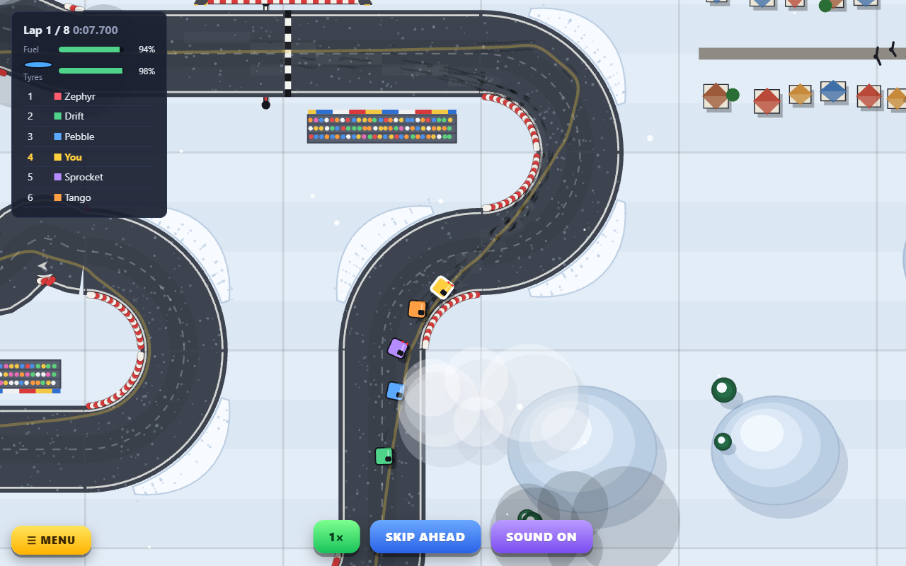

Turn on **Realism** and the car stops being a perfect machine.

**Three compounds**

| Tyre | In the dry | Wear | Notes |
| --- | --- | --- | --- |
| 🔴 **Soft** | The most grip (+6%) | Fastest: about 5 laps | Falls to almost nothing once the road is soaked |
| 🟡 **Medium** | Standard grip | About 10 laps | The sensible default. Poor once it rains |
| 🔵 **Wet** | 16% less grip | Gone in a few laps on a dry road | For rain: grips best on a wet track and lasts about 15 laps there |

These are at 1x wear. On longer races tyre life and fuel stretch, so that five stops cover fifty laps.

**Grip fades as the rubber wears**, gently for most of a set's life and then over a cliff in the last quarter, and it
fades as the lap goes. Cornering hard wears tyres faster than easy driving does.

**Fuel** burns with distance, and a full tank costs a little acceleration. However far the fuel use is turned up, a full
tank always lasts a lap and a half. Run dry and the car limps to the pits for an
emergency refuel: slow, with no new tyres, and then it carries on. Nothing is ever retired.

**Pit stops.** Queue them in the strategy panel (on Easy the pit wall calls them), and the car drives itself into the
pit lane beside the start straight, stops in its bay and rejoins on fresh tyres and a full tank. Cars leave the lane
first in, first out. Never stopping adds a time penalty, and so does missing a mandatory tyre.

**The track dries along the line that cars drive.** Rain wets the road unevenly. Every car that drives over a patch dries
it, so the racing line dries first, and that dry strip is where slicks want to be. Heavy traffic also polishes the line in
the wet (less grip) and rubbers it in when it is dry (more grip). Reading the road is half the game.

**Weather comes from the seed, and the forecast is vague.** You are told only whether a shower starts near the beginning,
the middle or the end of the race. Never the lap, the strength or how long it lasts.

  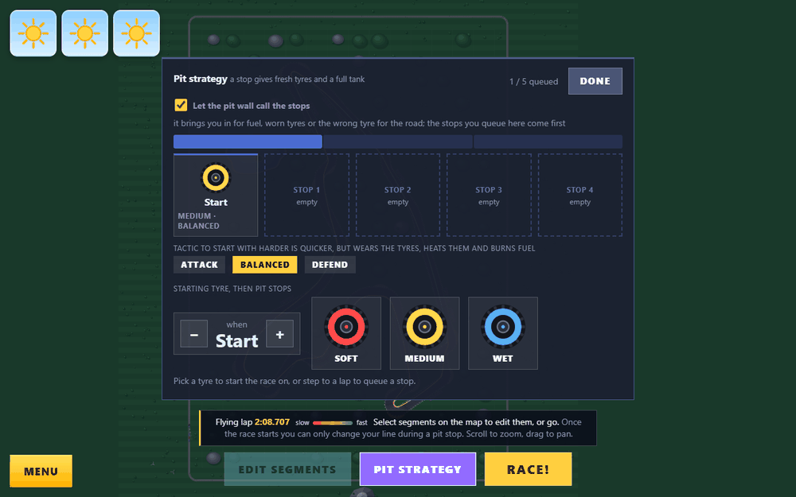

## Seeded tracks

A track comes from a memorable phrase such as `healthy-bear-eats-tuna`. **The same phrase always gives the same track**,
so sharing the phrase shares the track, the place and the cars. Any text works as a phrase.

What the phrase decides:

- **The layout.** A loop of 14 to 22 pieces on a small grid. It never has a dead end or a crossing where cars can meet, and it always comes
  back to the start. Pieces are straights, gentle bends, kinks, chicanes, esses, corners, sharp corners, sweepers and
  hairpin U-turns. Now and then (about one phrase in ten) the road runs over itself on a **bridge**: a figure of eight whose
  crossing is a raised deck, so cars on the bridge and on the road beneath it pass without touching. The start and finish always sit on plain straights, so there is room for the pit lane.
- **The place.** Countryside, desert, snow and ice, a city, the Moon, mountains and forest, the coast, jungle or a volcano
  (with lava where the lakes would be). Each changes grip, braking, acceleration, tyre
  wear and fuel use for everyone, and each has its own scenery: trains, planes, wind turbines, boats, villages.
- **What you drive.** One class of vehicle for the whole field: go-karts, formula cars, rally cars, muscle cars, trucks, tanks,
  superbikes, dune buggies, electric GTs, dragsters, rallycross cars and the racing classes (touring cars, prototypes, GT3, GT4, hypercars, stock cars, formula cars and classic F1) on land, and jet skis, speedboats, hovercraft and airboats on water.
- **The weather**, in a race with Realism on.
- **Secrets.** Some real circuits are hidden behind their names. Try typing a famous one as the phrase. Each races its best-known class: Donington Park touring cars, Daytona prototypes, Spa GT3, Lago Maggiore GT4, Silverstone F1 cars (Le Mans prototypes, Monza, Barcelona and Monaco F1, Laguna Seca GT3, Willow Springs GT4). There are about forty: Interlagos, Imola, Zandvoort, COTA, the Red Bull Ring, Suzuka, Fuji, Brands Hatch, Mugello, Sebring, Road America, Montréal and more, three layouts of the Nürburgring (`nurburgring`, `nurburgring-sprint`, `nordschleife`, at full scale, nearly 21 km) and some from Gran Turismo (`trial-mountain`, `high-speed-ring`, `dragon-trail`). Their shapes come from
  [OpenStreetMap](https://www.openstreetmap.org/copyright) (see [docs/CIRCUIT_CREDITS.md](docs/CIRCUIT_CREDITS.md)).
- **Fun tracks.** A phrase that starts with `fun-` (for example `fun-healthy-bear-eats-tuna`) is a fun track, and Random keeps the
  `fun-` and changes the rest. The road runs over itself at crossings (more often than not on a bridge, where the cars on the two levels never touch), narrows to a single-file bottleneck and opens out into wide
  arenas, and may have a shortcut: where the road forks, drag the diamond at the end of the segment onto the other exit and only
  that route is filled in. Open water turns up only on fun tracks, as likely as any other place. Boats have no grip: they carry
  speed into a corner and slide wide, hull at an angle to their path.

**Night and rain.** Some tracks are raced at night, under lamps and headlights. In the rain the road darkens and shines,
the dry line shows where the cars have been, rain rings the standing water and drops bead on the screen.

The address of the game holds the track, your settings and the segments you have drawn. Copy it to share a track, or
reload to carry on drawing. **Laps and times are never saved in it**, so a reload always starts the race afresh.

## Licence

MIT. See [LICENSE](LICENSE).

## For developers

Building from source, how the simulation and the renderer fit together, testing and releases are in
[DEVELOPER.md](DEVELOPER.md). Release notes are in [CHANGELOG.md](CHANGELOG.md).
